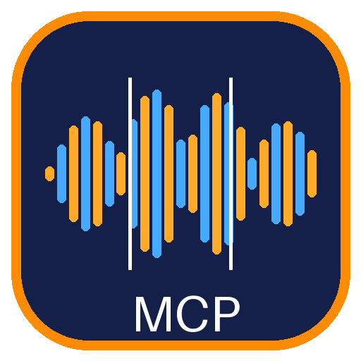

<h1 align="center">Sunsam-Code-Marketplace</h1>

<p align="center">
  <a href="README.md">English</a> · <a href="README.es.md">Español</a> · <a href="README.pt-BR.md">Português</a> · <a href="README.fr.md">Français</a> · <b>Deutsch</b> · <a href="README.ru.md">Русский</a> · <a href="README.zh-CN.md">简体中文</a> · <a href="README.ja.md">日本語</a> · <a href="README.ko.md">한국어</a>
</p>

<p align="center">MCP-Connectoren, die sich mit einem Klick in <a href="https://github.com/jhonsu01/SunsamCode">Sunsam Code</a> installieren lassen, mit Symbol, Beschreibung und Version. Der Marketplace <b>synchronisiert sich selbst</b> mit dem neuesten Release jedes Connectors.</p>

---

## In Sunsam Code verwenden

Er ist standardmäßig eingerichtet. Um ihn von Hand hinzuzufügen (oder einen anderen Marketplace):

1. **Einstellungen → MCP-Server → Marketplaces → Marketplace hinzufügen**.
2. Gib `jhonsu01/marketplace-SunsamCode` ein (oder die URL einer beliebigen `marketplace.json`).
3. Klicke bei einem Connector auf **Installieren**. Erscheint eine neue Version, wird **Aktualisieren** angezeigt und deine Einstellungen bleiben erhalten.

## Connectoren

| Connector | Was er tut | Kategorie | Paket |
| --- | --- | --- | --- |
|  [Audacity Bridge](https://github.com/jhonsu01/audacity-mcp-server) | Audio: in Stücke teilen, trimmen, konvertieren, Effekte, mischen und verbinden; WAV, MP3, FLAC, OGG | Audio | [`audacity-mcp-server.mcpb`](https://github.com/jhonsu01/audacity-mcp-server/releases/latest/download/audacity-mcp-server.mcpb) |
|  [DesignCraft Bridge](https://github.com/jhonsu01/designcraft-mcp-server) | Seitenlayout, Datenzusammenführung, InDesign-IDML, druckfertiges PDF/X, PNG, EPUB und HTML | Design | [`designcraft-mcp-server.mcpb`](https://github.com/jhonsu01/designcraft-mcp-server/releases/latest/download/designcraft-mcp-server.mcpb) |
|  [EffectCraft Bridge](https://github.com/jhonsu01/effectcraft-mcp-server) | Motion Graphics, animierte Titel, Effekte auf Videos, Vorlagen; MP4, ProRes, WebM, GIF, Lottie | Design | [`effectcraft-mcp-server.mcpb`](https://github.com/jhonsu01/effectcraft-mcp-server/releases/latest/download/effectcraft-mcp-server.mcpb) |
|  [FilmCraft Bridge](https://github.com/jhonsu01/filmcraft-mcp-server) | Videoschnitt: teilen, trimmen, Effekte, Farblooks, Titel, Tempo, mit Übergängen verbinden; H.264, ProRes, GIF, OTIO | Design | [`filmcraft-mcp-server.mcpb`](https://github.com/jhonsu01/filmcraft-mcp-server/releases/latest/download/filmcraft-mcp-server.mcpb) |
|  [LightCraft Bridge](https://github.com/jhonsu01/lightcraft-mcp-server) | Raw-Entwicklung: Auto-Tonwert, 114 Regler, Vorgaben, Masken, HDR und Panoramen; JPEG, TIFF, WebP, AVIF, DNG | Design | [`lightcraft-mcp-server.mcpb`](https://github.com/jhonsu01/lightcraft-mcp-server/releases/latest/download/lightcraft-mcp-server.mcpb) |
|  [PdfCraft Bridge](https://github.com/jhonsu01/pdfcraft-mcp-server) | PDF: zusammenführen, teilen, Seiten, OCR, Formulare, Signaturen, Schwärzen, Passwörter; nach Word, HTML, Bilder, PDF/A | Produktivität | [`pdfcraft-mcp-server.mcpb`](https://github.com/jhonsu01/pdfcraft-mcp-server/releases/latest/download/pdfcraft-mcp-server.mcpb) |
|  [PhotoCraft Bridge](https://github.com/jhonsu01/photocraft-mcp-server) | Bildbearbeitung: Größe, Zuschnitt, Korrekturen, 122 Filter, Hintergrund entfernen, Text und Designs; PSD, PNG, JPEG, WebP | Design | [`photocraft-mcp-server.mcpb`](https://github.com/jhonsu01/photocraft-mcp-server/releases/latest/download/photocraft-mcp-server.mcpb) |
|  [Vector Magic Bridge](https://github.com/jhonsu01/VectorMagic-mcp-server) | Vektorisiert Bitmaps, ein Bild oder ganze Ordner; SVG, AI, EPS, PDF, DXF (Windows) | Design | [`vectormagic-mcp-server.mcpb`](https://github.com/jhonsu01/VectorMagic-mcp-server/releases/latest/download/vectormagic-mcp-server.mcpb) |
|  [VectorCraft Bridge](https://github.com/jhonsu01/vectorcraft-mcp-server) | Vektorgrafik: Bilder nachzeichnen, Designs aus Formen, Text und Diagrammen, umfärben; SVG, PDF, AI, EPS, DXF, PNG | Design | [`vectorcraft-mcp-server.mcpb`](https://github.com/jhonsu01/vectorcraft-mcp-server/releases/latest/download/vectorcraft-mcp-server.mcpb) |
|  [WordCraft Bridge](https://github.com/jhonsu01/wordcraft-mcp-server) | Textverarbeitung: Dokumente mit Überschriften, Listen, Tabellen und Bildern, Suchen / Ersetzen, Kommentare, Änderungsverfolgung, Serienbriefe; DOCX, PDF, ODT, RTF, Markdown, LaTeX | Produktivität | [`wordcraft-mcp-server.mcpb`](https://github.com/jhonsu01/wordcraft-mcp-server/releases/latest/download/wordcraft-mcp-server.mcpb) |

Die aktuelle Version jedes Connectors steht immer in [`marketplace.json`](marketplace.json).

## Andere Apps

Dieselben `.mcpb`-Pakete lassen sich in **Claude Desktop** installieren (Doppelklick). Für **Codex** und **DeepSeek Harness** gibt es die Craft-Connectoren im [Craft-Bridges-Marketplace](https://github.com/jhonsu01/craft-marketplace).

## Funktionsweise

- [`sources.json`](sources.json) listet die Connector-Repositories (plus Kategorie, Farbe und Kurzbeschreibung).
- [`scripts/sync.mjs`](scripts/sync.mjs) liest das neueste Release jedes Repos, lädt dessen `.mcpb` herunter, berechnet die **SHA-256** und entnimmt dem Paket die `manifest.json` (Version, Name, Werkzeuge) und das **Symbol**. Es schreibt [`marketplace.json`](marketplace.json) und [`icons/`](icons), ohne Abhängigkeiten.
- Der [Workflow](.github/workflows/sync.yml) führt es alle 6 Stunden aus, von Hand oder wenn ein Connector ein neues Release meldet:

```bash
gh api repos/jhonsu01/marketplace-SunsamCode/dispatches -f event_type=connector-release
```

- Sunsam Code lädt die `.mcpb` aus dem ursprünglichen Release und **prüft die SHA-256** vor der Installation.

### Einen Connector hinzufügen

Füge sein Repository zu `sources.json` hinzu (es muss eine `.mcpb` in seinen GitHub Releases veröffentlichen) und führe `node scripts/sync.mjs` aus, oder überlass das dem Workflow.

### Format

Jede `marketplace.json`, die [`marketplace.schema.json`](marketplace.schema.json) folgt, funktioniert als Marketplace für Sunsam Code: So kannst du deinen eigenen veröffentlichen.

## Lizenz

Apache-2.0. Jeder Connector behält seine eigene Lizenz. Die Apps gehören ihren Autoren; diese Connectoren sind nicht mit ihnen verbunden und werden nicht von ihnen unterstützt.
